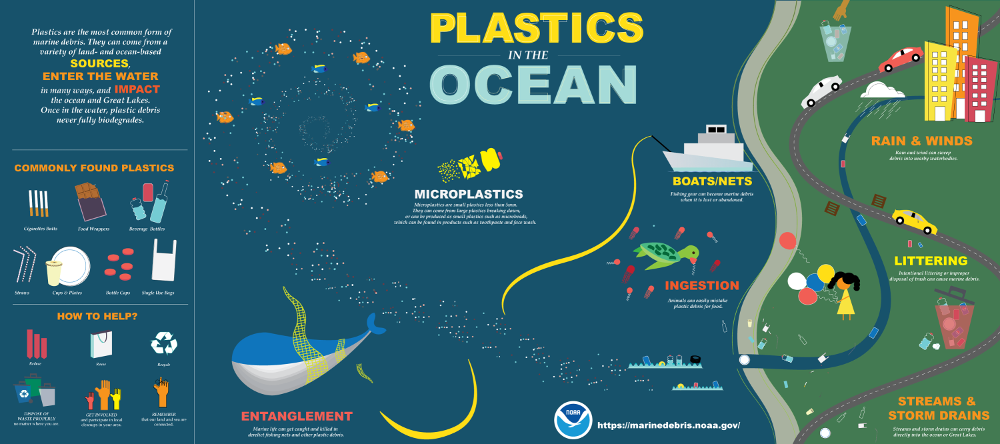

# MSDD: Marine Surface Debris Detection

**Arab Youth Space Hackathon, 813 Challenge**
**Theme 03: Marine and Water Security**



An end-to-end framework for detecting, mapping, and prioritizing floating marine debris in coastal waters from Sentinel-2 imagery.

---

## Overview

Marine Surface Debris Detection (MSDD) is an Earth observation and deep learning framework that detects and maps potential floating marine debris in coastal waters.

The system combines Sentinel-2 multispectral imagery, spectral indices, texture features, transformer-based semantic segmentation, and geospatial post-processing to turn satellite observations into actionable debris intelligence for environmental monitoring agencies, researchers, and coastal cleanup teams.

The project has two independent but complementary components. Each has its own README with full setup, training, and deployment instructions.

| Component | Description | README |
| --------- | ----------- | ------ |
| **MSDD-Net** | Deep learning pipeline: data loading, feature engineering, model training, evaluation, figure generation | [MSDD-Net/README.md](MSDD-Net/README.md) |
| **MSDD-App** | Flutter application: interactive debris map, danger levels, PDF reports | [MSDD-App/README.md](MSDD-App/README.md) |

---

## Pipeline

```
Sentinel-2 L2A Imagery
        |
        v
Feature Engineering  (MSDD-Net)
        |
        v
MSDD-Net Segmentation
        |
        v
Post-processing and Debris Report (CSV)
        |
        v
Interactive Map and PDF Export  (MSDD-App)
```

---

## Quick Start

### MSDD-Net (deep learning)

Requires Python 3.9 or newer.

```bash
cd MSDD-Net
python -m venv .venv
source .venv/bin/activate           # Windows: .venv\Scripts\activate

# Install CUDA-enabled PyTorch first 
pip install torch torchvision --index-url https://download.pytorch.org/whl/cu121
pip install -r requirements.txt

# Random Forest baseline (CPU, minutes)
python train_rf.py --features ss_si_glcm

# U-Net baseline (GPU, about 1 hour)
python train_marida.py --model unet

# MSDD-Net (GPU, about 6 to 10 hours)
python train_marida.py --model mssd --variant baseline

# Evaluate on the MARIDA test set
python evaluation_swin_unetv2.py --model_type swin --variant baseline
```

Full instructions: [MSDD-Net/README.md](MSDD-Net/README.md)

### MSDD-App (Flutter application)

Requires the Flutter SDK (3.27 or newer).

```bash
cd MSDD-App
flutter pub get
flutter run                    # Android emulator or connected phone
flutter run -d chrome          # in the browser
```

Full instructions: [MSDD-App/README.md](MSDD-App/README.md)

### Docker

Each component ships with its own Dockerfile and `docker-compose.yml`. See the subfolder README for full detail; the essentials are:

**MSDD-Net** (CPU image for Random Forest, CUDA image for training and GPU inference):

```bash
cd MSDD-Net
docker build -t msddnet:cpu --target cpu .
docker build -t msddnet:gpu --target gpu .

# Random Forest, CPU
docker run --rm -it \
    -v "$PWD/data:/workspace/data" \
    -v "$PWD/trained_models:/workspace/trained_models" \
    msddnet:cpu python train_rf.py --features ss_si_glcm

# MSDD-Net training, GPU
docker run --rm -it --gpus all \
    -v "$PWD/data:/workspace/data" \
    -v "$PWD/trained_models:/workspace/trained_models" \
    msddnet:gpu python train_marida.py --model mssd --variant baseline
```

**MSDD-App** (web build served by nginx):

```bash
cd MSDD-App
docker build -t msddapp .
docker run --rm -p 8080:80 msddapp
# open http://localhost:8080

# or with compose
docker compose up --build
```

Full Docker instructions: [MSDD-Net/README.md](MSDD-Net/README.md) and [MSDD-App/README.md](MSDD-App/README.md).

---

## Data

Two public, expert-annotated Sentinel-2 benchmarks are used. UAE / Arabian Gulf imagery is the deployment target for the app.

| Dataset | Patches | Patch size | Bands | Classes used | Source |
| ------- | ------: | ---------- | ----- | ------------ | ------ |
| MARIDA (Kikaki et al. 2022) | 1,381 | 256 x 256, 10 m | 11 | 11 after aggregation | [Zenodo](https://zenodo.org/record/5151941) |
| MADOS (Kikaki et al. 2024) | 2,803 | 240 x 240, padded to 256 | 11 | mapped to MARIDA's 11 | [Zenodo](https://zenodo.org/records/10430388) |

**Classes (11):** Marine Debris, Dense Sargassum, Sparse Sargassum, Natural Organic Material, Ship, Clouds, Marine Water, Sediment-Laden Water, Foam, Turbid Water, Shallow Water.

Waves, Cloud Shadows, Wakes, and Mixed Water are merged into Marine Water, matching the MARIDA paper.

Labels are sparse. Unlabelled pixels are ignored during training and evaluation. Marine Debris is roughly 0.4% of labelled pixels, so class weighting and optional oversampling are used during training.

### Pretrained checkpoints and prepared data

All pretrained weights, prepared datasets, and rendered figures are hosted on Google Drive.

| Artifact | Description | Link |
| -------- | ----------- | ---- |
| Trained checkpoints | U-Net, Random Forest, all MSDD-Net variants | [Google Drive](https://drive.google.com/file/d/1tpfs4i43Wr_WF6qJyqn3HPJAbEgtzIF2/view?usp=sharing) |

After unzipping `checkpoints.zip`, `MSDD-Net/trained_models/` should contain `unet/`, `rf_ss_si_glcm/`, `baseline/`, `full/`, and `only_residual/` subfolders.

---

## Results Summary

Full tables are in [MSDD-Net/docs/RESULTS.md](MSDD-Net/docs/RESULTS.md).

### MARIDA paper baselines (MARIDA test split)

| Model | Marine Debris IoU | Marine Debris F1 | Mean IoU | Mean F1 |
| ----- | ----------------: | ---------------: | -------: | ------: |
| RF_SS | 0.55 | 0.71 | 0.57 | 0.69 |
| RF_SS+SI | **0.67** | **0.80** | 0.59 | 0.70 |
| RF_SS+SI+GLCM | 0.65 | 0.79 | **0.69** | **0.79** |
| U-Net | 0.33 | 0.50 | 0.57 | 0.69 |

### MSDD-Net variants (held-out test split)

| Variant | Marine Debris F1 | Marine Debris IoU | Macro F1 | Macro mIoU |
| ------- | ---------------: | ----------------: | -------: | ---------: |
| **baseline** | **69.06%** | **52.74%** | **75.31%** | **64.69%** |
| only_residual | 67.53% | 50.98% | 74.88% | 64.07% |
| full | 56.77% | 39.63% | 71.69% | 60.11% |

**Main finding:** the plain Swin-UNet V2 baseline outperforms the full MSDD-Net on the target Marine Debris class by 12.29 F1 points. The additional architectural modules help larger, more spatially coherent classes but not the sparse debris target.

The two tables use different test sets and cannot be compared directly.

---

## Repository Structure

```
msdd-arab-youth-space-hackathon/
|
|-- README.md                This file
|-- assets/
|   `-- mssd_banner.png      Banner image
|
|-- MSDD-Net/                Deep learning pipeline (see MSDD-Net/README.md)
|   |-- Dockerfile
|   |-- docker-compose.yml
|   |-- requirements.txt
|   |-- docs/
|   `-- ...                  Training, evaluation, and figure scripts
|
`-- MSDD-App/                Flutter application (see MSDD-App/README.md)
    |-- Dockerfile
    |-- docker-compose.yml
    |-- pubspec.yaml
    `-- ...                  App source
```

---

## Documentation

| Document | Description |
| -------- | ----------- |
| [MSDD-Net/README.md](MSDD-Net/README.md) | Deep learning: installation, training, evaluation, figures, Docker |
| [MSDD-App/README.md](MSDD-App/README.md) | Flutter app: features, setup, deployment, Docker |
| [MSDD-Net/docs/PREPROCESSING.md](MSDD-Net/docs/PREPROCESSING.md) | Data preprocessing pipeline |
| [MSDD-Net/docs/TECHNICAL_DOCUMENT.md](MSDD-Net/docs/TECHNICAL_DOCUMENT.md) | Full methodology |
| [MSDD-Net/docs/RESULTS.md](MSDD-Net/docs/RESULTS.md) | Detailed evaluation results |
| [MSDD-Net/docs/BASELINES.md](MSDD-Net/docs/BASELINES.md) | U-Net and Random Forest baselines |

---

## Limitations

MSDD predictions are potential debris detections requiring further validation, not definitive confirmation of physical debris.

- Small debris can fall below Sentinel-2's effective spatial resolution.
- Sun glint and surface reflections can produce false positives.
- Floating algae, foam, and turbid water can have similar spectral responses.
- Limited ground-truth data affects generalization.
- Performance varies across geography, season, and environmental conditions.

MSDD is designed as a decision-support and prioritization system, not a replacement for field verification.

---

## Future Work

- **Multi-sensor fusion:** Sentinel-1 SAR, higher-resolution optical imagery, additional missions.
- **Temporal monitoring:** persistent accumulation hotspots, recurring patterns, seasonal trends.
- **Model improvements:** improved transformer variants, self-supervised pretraining, multimodal learning, uncertainty estimation.
- **Operational deployment:** automated acquisition, preprocessing, inference, hotspot detection, geospatial alert, human verification, and cleanup prioritization.

---

## Team

**Arab Youth Space Hackathon, 813 Challenge**
**Theme 03: Marine and Water Security**

- **Besma Guesmi**, Tech Team Lead
- **Afef Guesmi**, ML R&D, PhD Student in Earth Observation
- **Dorra Guesmi**, Full Stack Engineer

---

## License

- Code: MIT
- Sentinel-2 imagery: used under the Copernicus data terms
- Documentation: CC BY 4.0

---

## References

- Kikaki, K., Kakogeorgiou, I., Mikeli, P., Raitsos, D. E., Karantzalos, K. (2022). *MARIDA: A benchmark for Marine Debris detection from Sentinel-2 remote sensing data.* PLOS ONE.
- Kikaki, K., et al. (2024). *MADOS: A multi-class marine debris dataset for the detection of marine litter in Sentinel-2 imagery.*
- [NOAA Marine Debris Program](https://marinedebris.noaa.gov/)

---

**From satellite imagery to actionable marine-debris intelligence.**
